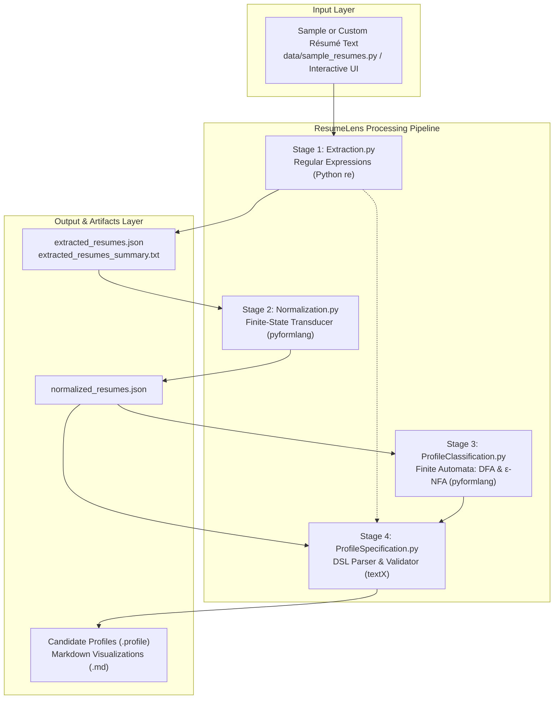

# Module Design & Architecture

## End-to-End System Flow



---

## Module Responsibilities and Data Contracts

| Module | Architectural Role | Inputs | Outputs |
| :--- | :--- | :--- | :--- |
| **`main.py`** | Central runner and interactive command-line UI. | Terminal inputs or CLI flags (`--run-all`, `--test`). | Coordinated execution of Stages 1–4, interactive screening, and test runner. |
| **`data/sample_resumes.py`** | Reference test corpus. | None. | List of 4 structured dictionaries containing candidate metadata and raw résumé text. |
| **`src/resumelens/Extraction.py`** | Stage 1: Information extraction using regular expressions. | Raw résumé text as `str`. | Dictionary of 9 extracted categories (`emails`, `languages`, `frameworks`, `databases`, etc.). |
| **`src/resumelens/Normalization.py`** | Stage 2: Canonicalization using a Finite-State Transducer (FST). | Extracted skill strings from Stage 1. | Dictionary containing `normalized` (unique canonical uppercase symbols) and `sorted_by_profile`. |
| **`src/resumelens/ProfileClassification.py`** | Stage 3: Profile pattern recognition using finite automata. | Normalized canonical skills from Stage 2. | Dictionary containing `accepted_profiles` and diagnostic stage details per profile. |
| **`src/resumelens/candidate_profile.tx`** | Stage 4 grammar specification. | DSL source strings. | Abstract Syntax Tree (AST) metamodel managed by `textX`. |
| **`src/resumelens/ProfileSpecification.py`** | Stage 4: DSL generation, AST parsing, and Markdown rendering. | Extracted records, normalized skills, and accepted profile verdicts. | Validated `.profile` files and `.md` candidate visualization reports. |

---

## Function Contracts by Module

### 1 Stage 1 — `Extraction.py`
- `clean_and_deduplicate(matches: list) -> list[str]`: Cleans, strips, and removes duplicate strings case-insensitively while preserving insertion order.
- `extract_resume_info(resume_text: str) -> dict`: Executes the 9 category regex patterns and returns a structured dictionary of extracted candidate data.
- `save_to_json_file(data: any, filepath: str) -> None`: Serializes data to formatted UTF-8 JSON.
- `save_to_text_file(candidates: list, filepath: str) -> None`: Generates a readable plain-text extraction summary.

### 2 Stage 2 — `Normalization.py`
- `build_transducer() -> FST`: Builds the `pyformlang.fst.FST` with transitions $(q_0, v, q_f, [\text{canon}])$ for all recognized spelling variants.
- `normalize_term(raw: str) -> str | None`: Feeds a lowercased token into the FST; returns the canonical symbol or `None` if unrecognized.
- `sort_for_profile(terms: list[str], profile: str) -> list[str]`: Orders canonical skills according to the profile's sequence definition.
- `normalize_resume(extracted_info: dict) -> dict`: Normalizes all extracted skills and generates sorted variants for each profile.

### 3 Stage 3 — `ProfileClassification.py`
- `create_profile_automaton(profile_name: str) -> Automaton`: Constructs an `EpsilonNFA` (Full Stack, ML Engineer) or `DeterministicFiniteAutomaton` (Data Engineer, DevOps) representing that profile's sequential stages.
- `canonical_profile_sequence(profile_name: str, normalized_skills: set[str]) -> list[str]`: Builds the linear sequence of symbols corresponding to the profile's matched stages.
- `classify_profile(skills_or_extracted_info: any) -> dict`: Evaluates candidate skills against all 4 automata and returns verdicts.
- `draw_automaton(profile_name: str, output_dir: str = None) -> Digraph`: Renders the transition graph using Graphviz.

### 4 Stage 4 — `ProfileSpecification.py`
- `build_candidate_profile_source(name, extracted, skills, profiles) -> str`: Formats candidate data into the candidate-profile DSL.
- `parse_candidate_profile(source: str) -> CandidateProfile`: Parses and validates the source string using `textX`.
- `render_candidate_markdown(profile: CandidateProfile) -> str`: Emits a clean, standard Markdown candidate report.
- `generate_candidate_profiles(output_dir: Path) -> list`: Loads records, validates all profiles, and writes `.profile` and `.md` files.

---

## Execution Pipeline Commands

From the project root directory, ResumeLens can be executed in two ways:

1. **Interactive UI (Recommended):**
   ```powershell
   python main.py
   ```
2. **Automated Headless Mode:**
   ```powershell
   python main.py --run-all
   ```
3. **Automated Test Suite:**
   ```powershell
   python main.py --test
   ```
