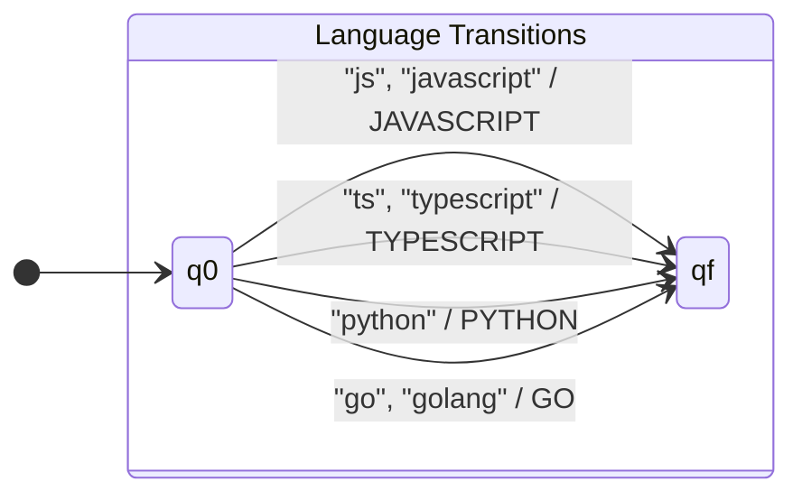
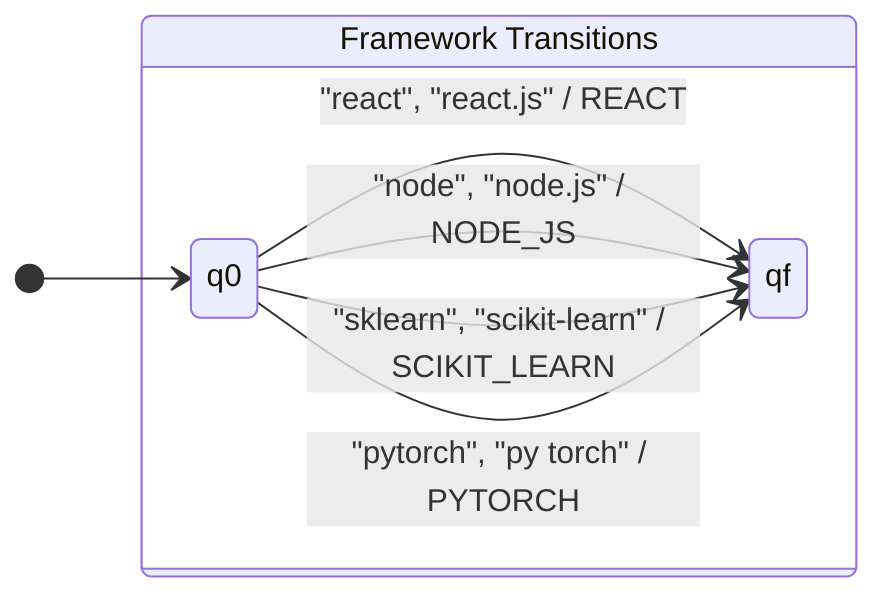
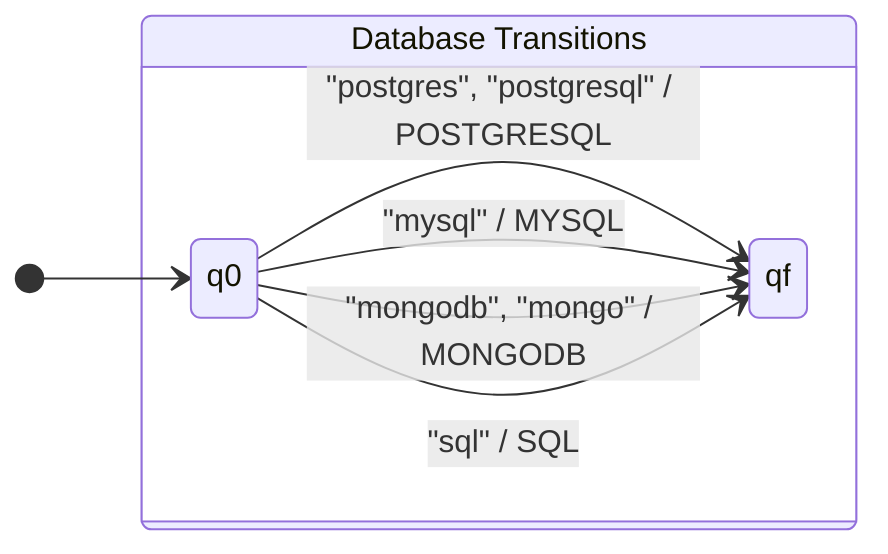
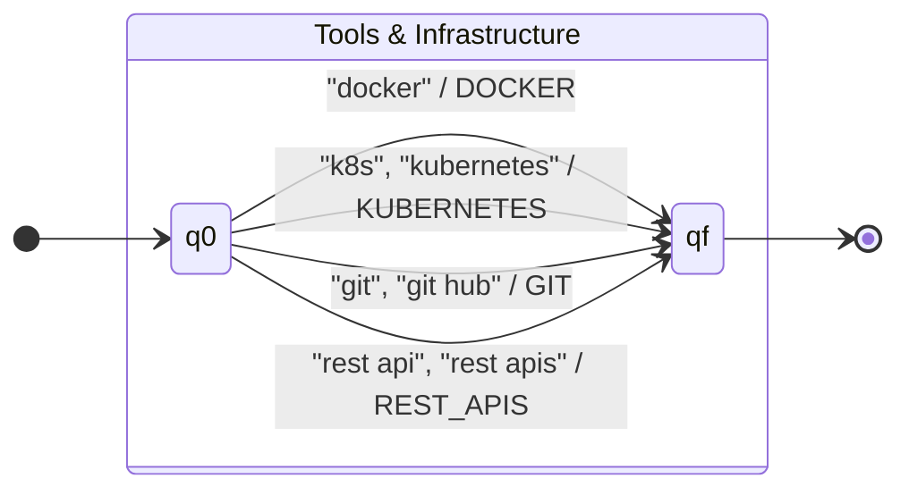

# Stage 2: Qualification Normalization (Finite-State Transducers)

## 1. Objective

Résumés frequently express identical qualifications through diverse spellings, abbreviations, or naming conventions (e.g., `JS` vs. `JavaScript`, `Postgres` vs. `PostgreSQL`, `scikit-learn` vs. `sklearn`). 

Stage 2 transforms raw extracted skill phrases into a **canonical, uppercase vocabulary** $\Gamma$ using a **Finite-State Transducer (FST)** implemented with `pyformlang`. It also sorts normalized qualifications according to the canonical order of each professional profile.

---

## 2. Formal Definition (7-Tuple)

The normalization model is formalized as a deterministic finite-state transducer operating on lowercased skill tokens:

$
M = (Q, \Sigma, \Gamma, \delta, \omega, q_0, F)
$

Where:
- **$Q = \{q_0, q_f\}$:** Finite set of internal states.
  - $q_0$: Initial state, waiting to consume an extracted token.
  - $q_f$: Accepting/final state, reached when an input token is recognized.
- **$\Sigma$ (Input Alphabet, $|\Sigma| = 97$):** The set of recognized skill variants and abbreviations (e.g., `javascript`, `js`, `react.js`, `postgres`, `scikit-learn`, `etl pipelines`).
- **$\Gamma$ (Output Alphabet, $|\Gamma| = 47$):** The canonical uppercase skill symbols (e.g., `JAVASCRIPT`, `REACT`, `POSTGRESQL`, `SCIKIT_LEARN`, `ETL_PIPELINES`).
- **$\delta: Q \times \Sigma \to Q$ (Transition Function):**
  $
  \delta(q_0, v) = q_f \quad \forall v \in \Sigma
  $
  All other transitions are undefined. Tokens outside $\Sigma$ have no valid transition and are directed to the `unrecognized` set.
- **$\omega: Q \times \Sigma \times Q \to \Gamma$ (Output Function):**
  Returns the canonical symbol for each recognized variant, such that:
  $
  \omega(q_0, \text{"js"}, q_f) = \text{JAVASCRIPT}, \quad \omega(q_0, \text{"postgres"}, q_f) = \text{POSTGRESQL}
  $
- **$q_0 \in Q$:** The unique start state.
- **$F = \{q_f\}$:** The set of accepting final states.

---

## 3. Graphical Representation of the Transducer

The transducer operates as a word-level rational relation. The diagram below illustrates its core transition architecture grouped by technological domain:






---

## 4. Canonical Vocabulary Mapping Table ($\Sigma \to \Gamma$)

| Domain | Raw Input Variants ($\Sigma$) | Canonical Output Symbol ($\Gamma$) |
| :--- | :--- | :--- |
| **Languages** | `javascript`, `js`<br>`typescript`, `ts`<br>`python`<br>`go`, `golang`<br>`bash`, `shell`<br>`sql`<br>`c++`, `cpp`<br>`c#`, `csharp` | `JAVASCRIPT`<br>`TYPESCRIPT`<br>`PYTHON`<br>`GO`<br>`BASH`<br>`SQL`<br>`C_PLUS_PLUS`<br>`C_SHARP` |
| **Frameworks** | `react`, `react.js`, `reactjs`<br>`angular`, `angular.js`<br>`vue`, `vue.js`<br>`node`, `node.js`, `nodejs`<br>`django`<br>`spring`, `spring boot`<br>`express`, `express.js`<br>`pandas`<br>`numpy`<br>`scikit-learn`, `sklearn`<br>`tensorflow`, `tensor flow`<br>`pytorch`, `py torch` | `REACT`<br>`ANGULAR`<br>`VUE`<br>`NODE_JS`<br>`DJANGO`<br>`SPRING_BOOT`<br>`EXPRESS`<br>`PANDAS`<br>`NUMPY`<br>`SCIKIT_LEARN`<br>`TENSORFLOW`<br>`PYTORCH` |
| **Databases** | `postgres`, `postgresql`<br>`mysql`<br>`mongodb`, `mongo`<br>`snowflake`<br>`bigquery`<br>`nosql`, `no sql` | `POSTGRESQL`<br>`MYSQL`<br>`MONGODB`<br>`SNOWFLAKE`<br>`BIGQUERY`<br>`NOSQL` |
| **Tools & Cloud** | `git`<br>`github`, `git hub`<br>`docker`<br>`kubernetes`, `k8s`<br>`terraform`<br>`ansible`<br>`jenkins`<br>`ci/cd`, `ci-cd`<br>`aws`, `amazon web services`<br>`azure`<br>`linux` | `GIT`<br>`GITHUB`<br>`DOCKER`<br>`KUBERNETES`<br>`TERRAFORM`<br>`ANSIBLE`<br>`JENKINS`<br>`CI_CD`<br>`AWS`<br>`AZURE`<br>`LINUX` |
| **Profile Skills** | `rest api`, `restful apis`<br>`machine-learning model development`<br>`etl`, `etl pipelines`<br>`data warehousing` | `REST_APIS`<br>`ML_MODEL_DEVELOPMENT`<br>`ETL_PIPELINES`<br>`DATA_WAREHOUSING` |

---

## 5. Profile-Based Canonical Sorting

Before evaluating candidate skills with the Stage 3 classification automata, the normalized tokens are organized in a **deterministic sequence** according to each professional profile. This ensures that classification never depends on the arbitrary order in which qualifications were written in the CV.

| Professional Profile | Canonical Evaluation Order |
| :--- | :--- |
| **Full Stack Developer** | `JAVASCRIPT → TYPESCRIPT → REACT → ANGULAR → VUE → NODE_JS → EXPRESS → DJANGO → SPRING_BOOT → SQL → POSTGRESQL → MYSQL → MONGODB → NOSQL → REST_APIS → GIT → GITHUB` |
| **Machine Learning Engineer** | `PYTHON → PANDAS → NUMPY → SCIKIT_LEARN → TENSORFLOW → PYTORCH → ML_MODEL_DEVELOPMENT → SQL → POSTGRESQL → GIT → GITHUB` |
| **Data Engineer** | `PYTHON → SCALA → SQL → POSTGRESQL → APACHE_SPARK → ETL_PIPELINES → DATA_WAREHOUSING → AIRFLOW → KAFKA → SNOWFLAKE → BIGQUERY → AWS → DOCKER → LINUX → GIT → GITHUB` |
| **DevOps Engineer** | `BASH → PYTHON → GO → DOCKER → KUBERNETES → TERRAFORM → ANSIBLE → JENKINS → CI_CD → AWS → AZURE → LINUX → NGINX → GIT → GITHUB` |

---

## 6. Execution & Output Files

When executed via `python src/resumelens/Normalization.py` or through `main.py`, the stage writes the results to `output/normalized_resumes.json`:

```json
{
  "candidate_name": "Wednesday Addams",
  "target_profile": "Full Stack Developer",
  "normalized": [
    "JAVASCRIPT", "TYPESCRIPT", "REACT", "NODE_JS", "POSTGRESQL", "REST_APIS", "GIT", "GITHUB"
  ],
  "unrecognized": []
}
```