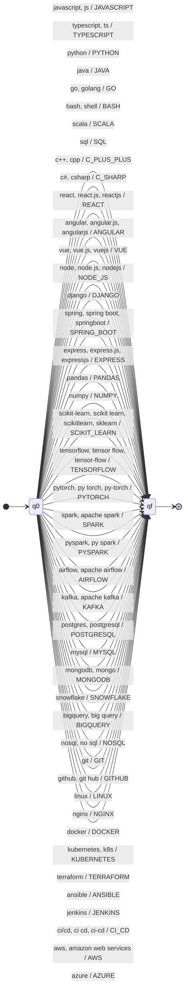

### Stage 2 - Normalization

Stage 2 converts Stage 1 terms to canonical names, removes duplicates, and sorts them
according to the selected profile. Input terms are lowercased before translation.

Code: [`src/stage2/normalization.py`](../src/stage2/normalization.py)  
Run: `python src/stage2/normalization.py`

#### Transducer definition

The transformations are implemented with `pyformlang`. The deterministic transducer is:

**M = (Q, Σ, Γ, δ, ω, q0, F)**

- **Q** (states) = {q0, qf}. `q0` is the initial state; `qf` means the input token
  was recognized.
- **Σ** (input alphabet, |Σ| = 82) = {javascript, js, typescript, ts, python, java, go, golang,
  bash, shell, scala, sql, c++, cpp, c#, csharp, react, react.js, reactjs, angular,
  angular.js, angularjs, vue, vue.js, vuejs, node, node.js, nodejs, django, spring,
  spring boot, springboot, express, express.js, expressjs, pandas, numpy, scikit-learn,
  scikit learn, scikitlearn, sklearn, tensorflow, tensor flow, tensor-flow, pytorch,
  py torch, py-torch, spark, apache spark, pyspark, py spark, airflow, apache airflow,
  kafka, apache kafka, postgres, postgresql, mysql, mongodb, mongo, snowflake, bigquery,
  big query, nosql, no sql, git, github, git hub, linux, nginx, docker, kubernetes, k8s,
  terraform, ansible, jenkins, ci/cd, ci cd, ci-cd, aws, amazon web services, azure}.
- **Γ** (Gamma; output alphabet, |Γ| = 44) = {JAVASCRIPT, TYPESCRIPT, PYTHON, JAVA, GO, BASH,
  SCALA, SQL, C_PLUS_PLUS, C_SHARP, REACT, ANGULAR, VUE, NODE_JS, DJANGO, SPRING_BOOT,
  EXPRESS, PANDAS, NUMPY, SCIKIT_LEARN, TENSORFLOW, PYTORCH, SPARK, PYSPARK, AIRFLOW,
  KAFKA, POSTGRESQL, MYSQL, MONGODB, SNOWFLAKE, BIGQUERY, NOSQL, GIT, GITHUB, LINUX,
  NGINX, DOCKER, KUBERNETES, TERRAFORM, ANSIBLE, JENKINS, CI_CD, AWS, AZURE}.
- **δ** (transition relation) = {(q0, v, qf) | v ∈ Σ}. Equivalently,
  δ(q0, v) = qf for every v ∈ Σ; all other transitions are undefined.
- **ω** (output function) is defined for each transition (q0, v, qf) and returns its
  canonical name in Γ, as labeled after `/` on the diagram; e.g.,
  ω(q0, `js`, qf) = JAVASCRIPT and ω(q0, `postgres`, qf) = POSTGRESQL.
- **q0** (initial state) = q0.
- **F** (accepting states) = {qf}. A token is accepted exactly when its transition
  reaches qf.

Each input is one whole, lowercased token. The transducer is deterministic and has no
ε-transitions. Tokens outside Σ have no accepting transition and are reported as
`unrecognized`.

#### Canonicalization and transition diagram

Each edge shows accepted input variants and their canonical output. This diagram defines
the input and output alphabets and the output function.

Example: `JS, ReactJS, Node.js` becomes `JAVASCRIPT, REACT, NODE_JS`.

#### Profile sorting

Duplicates are removed. Known terms follow the profile order; other terms are placed last.

| Profile | Canonical order |
|---|---|
| Full Stack Developer | `JAVASCRIPT → TYPESCRIPT → REACT → ANGULAR → VUE → NODE_JS → EXPRESS → DJANGO → SPRING_BOOT → SQL → POSTGRESQL → MYSQL → MONGODB → NOSQL → GIT → GITHUB` |
| Machine Learning Engineer | `PYTHON → PANDAS → NUMPY → SCIKIT_LEARN → TENSORFLOW → PYTORCH → SQL → POSTGRESQL → GIT` |
| Data Engineer | `PYTHON → SCALA → SQL → SPARK → PYSPARK → AIRFLOW → KAFKA → POSTGRESQL → SNOWFLAKE → BIGQUERY → AWS → DOCKER → LINUX → GIT` |
| DevOps Engineer | `BASH → PYTHON → GO → DOCKER → KUBERNETES → TERRAFORM → ANSIBLE → JENKINS → CI_CD → AWS → AZURE → LINUX → NGINX → GIT → GITHUB` |
