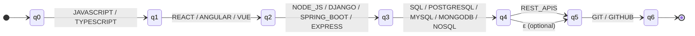
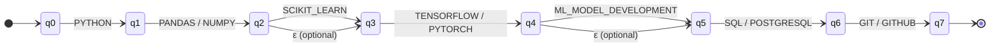
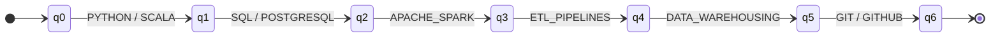

# Stage 3: Qualification Pattern Recognition (Finite Automata)

## 1. Objective

Stage 3 uses **Finite State Automata (FA)** to classify a candidate's qualifications against four professional profiles:
1. **Full Stack Developer** (Predefined Reference Profile)
2. **Machine Learning Engineer** (Predefined Reference Profile)
3. **Data Engineer** (Team Profile — AI / Data area)
4. **DevOps Engineer** (Team Profile — Software Engineering area)

The automata operate over the canonical skill symbols produced by Stage 2. To accommodate optional qualifications described in the project guidelines, **Full Stack Developer** and **Machine Learning Engineer** are modeled as **Nondeterministic Finite Automata with $\epsilon$-transitions ($\epsilon$-NFA)**, while **Data Engineer** and **DevOps Engineer** are modeled as **Deterministic Finite Automata (DFA)**.

---

## 2. Formal Automata Definitions (5-Tuple)

Every profile automaton is formally defined by the standard 5-tuple:
$
M = (Q, \Sigma, \delta, q_0, F)
$

---

### 2.1 Full Stack Developer ($\epsilon$-NFA)

- **Automaton Type:** $\epsilon$-NFA (justified by the optional `REST_APIS` stage, which can be bypassed via an $\epsilon$-transition).
- **$Q$ (States):** $\{q_0, q_1, q_2, q_3, q_4, q_5, q_6\}$.
- **$\Sigma$ (Alphabet):**
  $\{\texttt{JAVASCRIPT}, \texttt{TYPESCRIPT}, \texttt{REACT}, \texttt{ANGULAR}, \texttt{VUE}, \texttt{NODE_JS}, \texttt{DJANGO}, \texttt{SPRING_BOOT}, \texttt{EXPRESS}, \texttt{SQL}, \texttt{POSTGRESQL}, \texttt{MYSQL}, \texttt{MONGODB}, \texttt{NOSQL}, \texttt{REST_APIS}, \texttt{GIT}, \texttt{GITHUB}\}$.
- **$q_0$:** Initial state $q_0$.
- **$F$:** Accepting set $\{q_6\}$.
- **Transition Relation ($\delta$):**
  - $\delta(q_0, \texttt{JAVASCRIPT}) = \delta(q_0, \texttt{TYPESCRIPT}) = \{q_1\}$
  - $\delta(q_1, \texttt{REACT}) = \delta(q_1, \texttt{ANGULAR}) = \delta(q_1, \texttt{VUE}) = \{q_2\}$
  - $\delta(q_2, \texttt{NODE\_JS}) = \delta(q_2, \texttt{DJANGO}) = \delta(q_2, \texttt{SPRING\_BOOT}) = \delta(q_2, \texttt{EXPRESS}) = \{q_3\}$
  - $\delta(q_3, \texttt{SQL}) = \delta(q_3, \texttt{POSTGRESQL}) = \delta(q_3, \texttt{MYSQL}) = \delta(q_3, \texttt{MONGODB}) = \delta(q_3, \texttt{NOSQL}) = \{q_4\}$
  - $\delta(q_4, \texttt{REST\_APIS}) = \{q_5\}$ *(Mandatory transition when present)*
  - $\delta(q_4, \epsilon) = \{q_5\}$ *(Optional transition skipping REST APIs)*
  - $\delta(q_5, \texttt{GIT}) = \delta(q_5, \texttt{GITHUB}) = \{q_6\}$

---


---

### 2.2 Machine Learning Engineer ($\epsilon$-NFA)

- **Automaton Type:** $\epsilon$-NFA (justified by the optional `SCIKIT_LEARN` and `ML_MODEL_DEVELOPMENT` stages, allowing candidates with deep learning focus or varied skill combinations to be accepted).
- **$Q$ (States):** $\{q_0, q_1, q_2, q_3, q_4, q_5, q_6, q_7\}$.
- **$\Sigma$ (Alphabet):**
  $\{\texttt{PYTHON}, \texttt{PANDAS}, \texttt{NUMPY}, \texttt{SCIKIT\_LEARN}, \texttt{TENSORFLOW}, \texttt{PYTORCH}, \texttt{ML\_MODEL\_DEVELOPMENT}, \texttt{SQL}, \texttt{POSTGRESQL}, \texttt{GIT}, \texttt{GITHUB}\}$.
- **$q_0$:** Initial state $q_0$.
- **$F$:** Accepting set $\{q_7\}$.
- **Transition Relation ($\delta$):**
  - $\delta(q_0, \texttt{PYTHON}) = \{q_1\}$
  - $\delta(q_1, \texttt{PANDAS}) = \delta(q_1, \texttt{NUMPY}) = \{q_2\}$
  - $\delta(q_2, \texttt{SCIKIT\_LEARN}) = \{q_3\}$, and $\delta(q_2, \epsilon) = \{q_3\}$
  - $\delta(q_3, \texttt{TENSORFLOW}) = \delta(q_3, \texttt{PYTORCH}) = \{q_4\}$
  - $\delta(q_4, \texttt{ML\_MODEL\_DEVELOPMENT}) = \{q_5\}$, and $\delta(q_4, \epsilon) = \{q_5\}$
  - $\delta(q_5, \texttt{SQL}) = \delta(q_5, \texttt{POSTGRESQL}) = \{q_6\}$
  - $\delta(q_6, \texttt{GIT}) = \delta(q_6, \texttt{GITHUB}) = \{q_7\}$



---

### 2.3 Data Engineer (DFA)

- **Automaton Type:** DFA (Deterministic Finite Automaton). All stages are strictly sequential and mandatory.
- **$Q$ (States):** $\{q_0, q_1, q_2, q_3, q_4, q_5, q_6\}$.
- **$\Sigma$ (Alphabet):**
  $\{\texttt{PYTHON}, \texttt{SCALA}, \texttt{SQL}, \texttt{POSTGRESQL}, \texttt{APACHE\_SPARK}, \texttt{ETL\_PIPELINES}, \texttt{DATA\_WAREHOUSING}, \texttt{GIT}, \texttt{GITHUB}\}$.
- **$q_0$:** Initial state $q_0$.
- **$F$:** Accepting set $\{q_6\}$.
- **Transition Function ($\delta$):**
  - $\delta(q_0, \texttt{PYTHON}) = \delta(q_0, \texttt{SCALA}) = q_1$
  - $\delta(q_1, \texttt{SQL}) = \delta(q_1, \texttt{POSTGRESQL}) = q_2$
  - $\delta(q_2, \texttt{APACHE\_SPARK}) = q_3$
  - $\delta(q_3, \texttt{ETL\_PIPELINES}) = q_4$
  - $\delta(q_4, \texttt{DATA\_WAREHOUSING}) = q_5$
  - $\delta(q_5, \texttt{GIT}) = \delta(q_5, \texttt{GITHUB}) = q_6$



---

### 2.4 DevOps Engineer (DFA)

- **Automaton Type:** DFA. Models a comprehensive continuous integration and cloud deployment infrastructure pipeline.
- **$Q$ (States):** $\{q_0, q_1, q_2, \dots, q_{13}\}$.
- **$\Sigma$ (Alphabet):**
  $\{\texttt{BASH}, \texttt{PYTHON}, \texttt{GO}, \texttt{DOCKER}, \texttt{KUBERNETES}, \texttt{TERRAFORM}, \texttt{ANSIBLE}, \texttt{JENKINS}, \texttt{CI\_CD}, \texttt{AWS}, \texttt{AZURE}, \texttt{LINUX}, \texttt{NGINX}, \texttt{GIT}, \texttt{GITHUB}\}$.
- **$q_0$:** Initial state $q_0$.
- **$F$:** Accepting set $\{q_{13}\}$.
- **Transition Function ($\delta$):**
  - $\delta(q_0, \texttt{BASH}) = q_1$
  - $\delta(q_1, \texttt{PYTHON}) = q_2$
  - $\delta(q_2, \texttt{GO}) = q_3$
  - $\delta(q_3, \texttt{DOCKER}) = q_4$
  - $\delta(q_4, \texttt{KUBERNETES}) = q_5$
  - $\delta(q_5, \texttt{TERRAFORM}) = q_6$
  - $\delta(q_6, \texttt{ANSIBLE}) = q_7$
  - $\delta(q_7, \texttt{JENKINS}) = q_8$
  - $\delta(q_8, \texttt{CI\_CD}) = q_9$
  - $\delta(q_9, \texttt{AWS}) = \delta(q_9, \texttt{AZURE}) = q_{10}$
  - $\delta(q_{10}, \texttt{LINUX}) = q_{11}$
  - $\delta(q_{11}, \texttt{NGINX}) = q_{12}$
  - $\delta(q_{12}, \texttt{GIT}) = \delta(q_{12}, \texttt{GITHUB}) = q_{13}$

```mermaid
stateDiagram-v2
    direction LR
    [*] --> q0
    q0 --> q1: BASH
    q1 --> q2: PYTHON
    q2 --> q3: GO
    q3 --> q4: DOCKER
    q4 --> q5: KUBERNETES
    q5 --> q6: TERRAFORM
    q6 --> q7: ANSIBLE
    q7 --> q8: JENKINS
    q8 --> q9: CI_CD
    q9 --> q10: AWS / AZURE
    q10 --> q11: LINUX
    q11 --> q12: NGINX
    q12 --> q13: GIT / GITHUB
    q13 --> [*]
```



---

## 3. Implementation Details with pyformlang

Automata are instantiated via `pyformlang.finite_automaton.DeterministicFiniteAutomaton` and `EpsilonNFA`.

```python
from pyformlang.finite_automaton import DeterministicFiniteAutomaton, EpsilonNFA, State, Symbol, Epsilon

automaton = EpsilonNFA() if optional_stages else DeterministicFiniteAutomaton()
```

Each stage transition adds:
```python
automaton.add_transition(State(f"q{i}"), Symbol(skill), State(f"q{i+1}"))
if is_optional:
    automaton.add_transition(State(f"q{i}"), Epsilon(), State(f"q{i+1}"))
```

### Verification Against Official Task Examples
- **Full Stack Example:** `['JAVASCRIPT', 'REACT', 'NODE_JS', 'POSTGRESQL', 'GIT']`
  $\implies$ Consumes transitions through $q_0 \dots q_4$, takes $\epsilon$-transition $q_4 \to q_5$, and consumes `GIT` to reach $q_6 \in F$. **ACCEPTED**.
- **Machine Learning Example:** `['PYTHON', 'PANDAS', 'TENSORFLOW', 'POSTGRESQL', 'GIT']`
  $\implies$ Skips Scikit-learn via $q_2 \xrightarrow{\epsilon} q_3$, consumes `TENSORFLOW` to $q_4$, skips model development via $q_4 \xrightarrow{\epsilon} q_5$, consumes `POSTGRESQL` to $q_6$, and consumes `GIT` to reach $q_7 \in F$. **ACCEPTED**.
