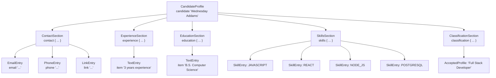

# Stage 4: Candidate Profile Language (CFG & textX)

## 1. Objective

Stage 4 defines and implements a **Domain-Specific Language (DSL)** based on a **Context-Free Grammar (CFG)** to represent the structured candidate information produced by Stages 1 to 3. Using the `textX` library, the system parses and validates candidate profile specifications, rejecting malformed lexical or syntactic inputs, and generating standardized Markdown visualizations.

---

## 2. Formal Grammar Definition (EBNF)

The formal candidate profile grammar $G = (V, \Sigma, R, S)$ is defined in Extended Backus-Naur Form (EBNF):

```ebnf
CandidateProfile = "candidate", STRING, "{",
                   ContactSection,
                   ExperienceSection,
                   EducationSection,
                   SkillsSection,
                   ClassificationSection, "}" ;

ContactSection   = "contact", "{", { ContactEntry }, "}" ;
ContactEntry     = EmailEntry | PhoneEntry | LinkEntry ;
EmailEntry       = "email", STRING, ";" ;
PhoneEntry       = "phone", STRING, ";" ;
LinkEntry        = "link", STRING, ";" ;

ExperienceSection = "experience", "{", { TextEntry }, "}" ;
EducationSection  = "education",  "{", { TextEntry }, "}" ;
TextEntry         = "item", STRING, ";" ;

SkillsSection     = "skills", "{", { SkillEntry }, "}" ;
SkillEntry        = "skill", ID, ";" ;

ClassificationSection = "classification", "{", { AcceptedProfile }, "}" ;
AcceptedProfile       = "accepted", STRING, ";" ;
```

### 2.1 Terminals and Non-Terminals

- **Non-terminal Alphabet ($V$):**
  `{ CandidateProfile, ContactSection, ContactEntry, EmailEntry, PhoneEntry, LinkEntry, ExperienceSection, EducationSection, TextEntry, SkillsSection, SkillEntry, ClassificationSection, AcceptedProfile }`.
- **Terminal Alphabet ($\Sigma$):**
  Keywords and punctuation: `{"candidate", "contact", "email", "phone", "link", "experience", "education", "item", "skills", "skill", "classification", "accepted", "{", "}", ";"}`, along with lexical tokens `STRING` (quoted text literals) and `ID` (canonical skill identifiers such as `JAVASCRIPT`, `POSTGRESQL`, `NODE_JS`).
- **Start Symbol ($S$):** `CandidateProfile`.

---

## 3. Structural Characteristics & Abstract Syntax Tree (AST)

The language features a hierarchical, declarative block structure. Each candidate profile contains five mandatory sections, where subsections allow zero or more repeated entries (`{ ... }`), accurately capturing real-world résumés with multiple contact channels, work experiences, or qualifications.



---

## 4. Theoretical Foundation: Grammar Simplification & Normal Forms

In formal language theory, standard context-free grammars can contain redundancies, null ($\epsilon$) productions, unit productions, or unconstrained rule lengths that hinder parsing efficiency. 

### 4.1 Grammar Simplification Algorithm
Before transforming a CFG into normal form, three simplification stages are applied:

1. **Elimination of Useless Symbols:**
   - *Non-generating symbols:* Variables from which no terminal string can be derived ($A \not\Rightarrow^* w, w \in \Sigma^*$). In our grammar, all non-terminals produce valid terminal sequences (e.g., `TextEntry` derives `"item", STRING, ";"`).
   - *Unreachable symbols:* Variables that cannot be derived from start symbol $S$ ($S \not\Rightarrow^* \alpha A \beta$). All defined non-terminals in `candidate_profile.tx` are connected to `CandidateProfile`.
2. **Elimination of $\epsilon$-Productions:**
   - In EBNF, `{ Entry }` represents zero or more repetitions ($A \to \epsilon \mid A \text{ Entry}$). To simplify, null productions are eliminated by declaring explicit non-empty sequences or using optional section wrappers.
3. **Elimination of Unit Productions ($A \to B$):**
   - The rule `ContactEntry = EmailEntry | PhoneEntry | LinkEntry` is a set of unit productions. Replacing $A \to B$ by substituting $B$'s right-hand sides directly yields:
     $
     \text{ContactEntry} \to \text{"email" } \text{STRING } \text{";"} \mid \text{"phone" } \text{STRING } \text{";"} \mid \text{"link" } \text{STRING } \text{";"}
     $

### 4.2 Chomsky Normal Form (CNF) Equivalence
A context-free grammar is in **Chomsky Normal Form (CNF)** if every production rule is of the form:
$
A \to B C \quad \text{or} \quad A \to a
$
where $A, B, C \in V$ and $a \in \Sigma$.

Transforming rules from `candidate_profile.tx` into CNF guarantees that recognition can be performed in polynomial time $O(n^3)$ via the **Cocke-Younger-Kasami (CYK)** dynamic programming algorithm.

**Example CNF Transformation for `SkillEntry = "skill", ID, ";"`:**
1. Introduce variable replacements for terminal tokens:
   - $T_{\text{skill}} \to \text{"skill"}$
   - $T_{\text{semi}} \to \text{";"}$
   - $T_{\text{id}} \to \text{ID}$
2. Break ternary derivation into binary steps:
   - $\text{SkillEntry} \to T_{\text{skill}} \, X_1$
   - $X_1 \to T_{\text{id}} \, T_{\text{semi}}$

All productions now adhere strictly to $A \to B C$ or $A \to a$, establishing theoretical compliance with **RAA3**.

---

## 5. Implementation with textX & Validation Pipeline

The grammar is loaded via `metamodel_from_file('candidate_profile.tx')`.

```python
from textx import metamodel_from_file
metamodel = metamodel_from_file('candidate_profile.tx')
profile_ast = metamodel.model_from_str(candidate_dsl_text)
```

### 5.1 Validation Rules
1. **Lexical Validation:** Identifiers must strictly conform to valid token formats (e.g., uppercase canonical skill symbols like `POSTGRESQL`).
2. **Syntactic Validation:** Required section braces, keyword delimiters, and semicolons are strictly enforced; missing brackets or sections raise a `TextXSyntaxError`.
3. **Semantic Validation:** Python assertions verify that any profile listed in `accepted "..."` belongs to the four authorized profiles supported by Stage 3.

---

## 6. Visualization Output (Markdown)

Upon validation, `render_candidate_markdown(profile)` translates the AST into a structured Markdown document saved to `output/candidate_profiles/{index}_{name}.md`.

Example output excerpt:
```markdown
# Candidate: Wednesday Addams

## Contact
- **Email:** wednesday.addams@nevermore.edu
- **Phone:** +1 555-0199
- **Link:** https://github.com/wednesday-addams

## Normalized skills
- `JAVASCRIPT`
- `REACT`
- `NODE_JS`
- `POSTGRESQL`
- `GIT`

## Profile classification
- Full Stack Developer
```
